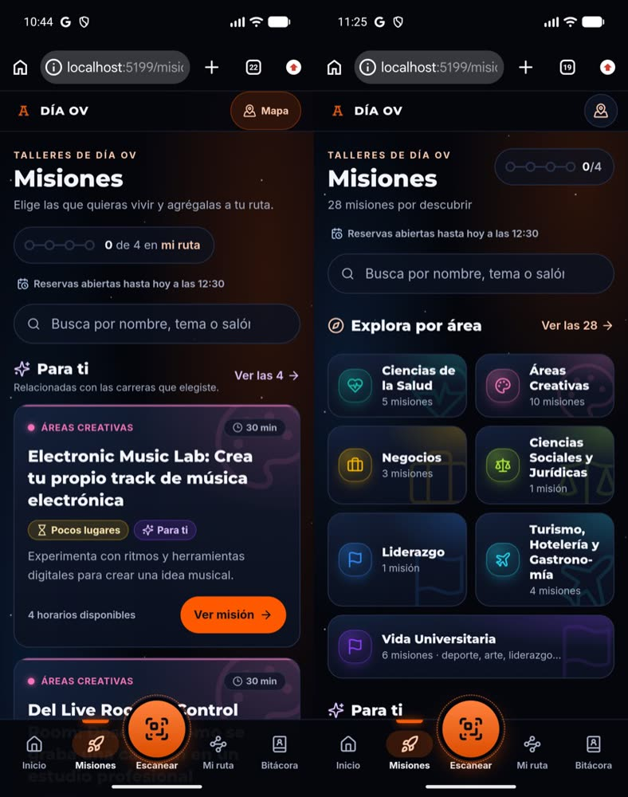
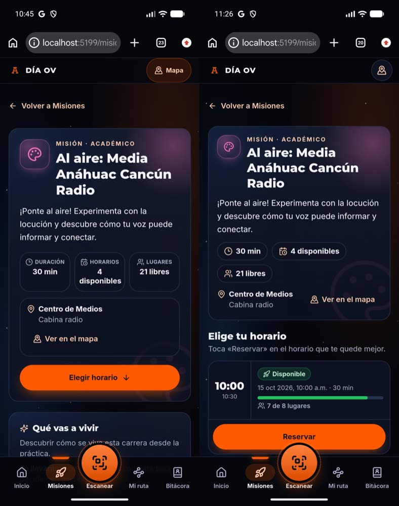
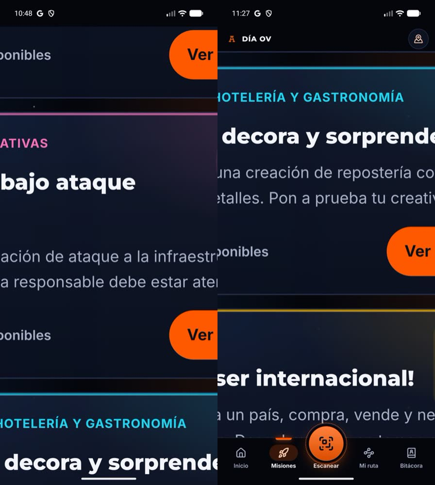
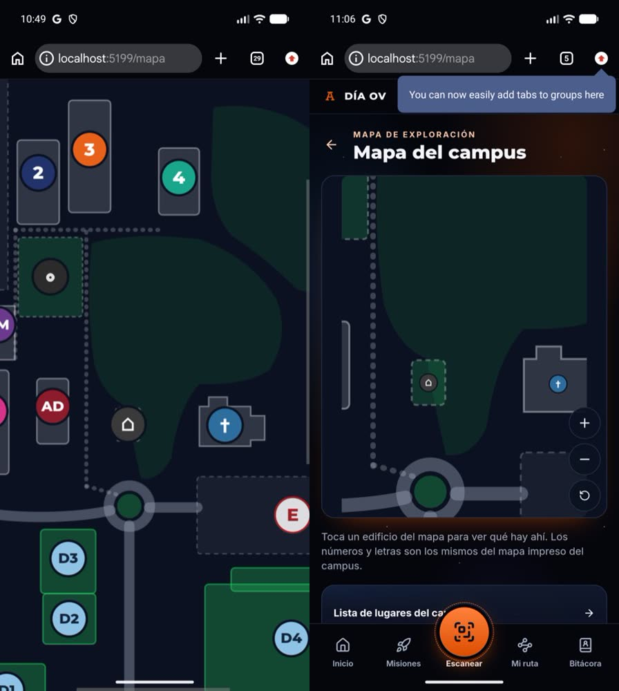
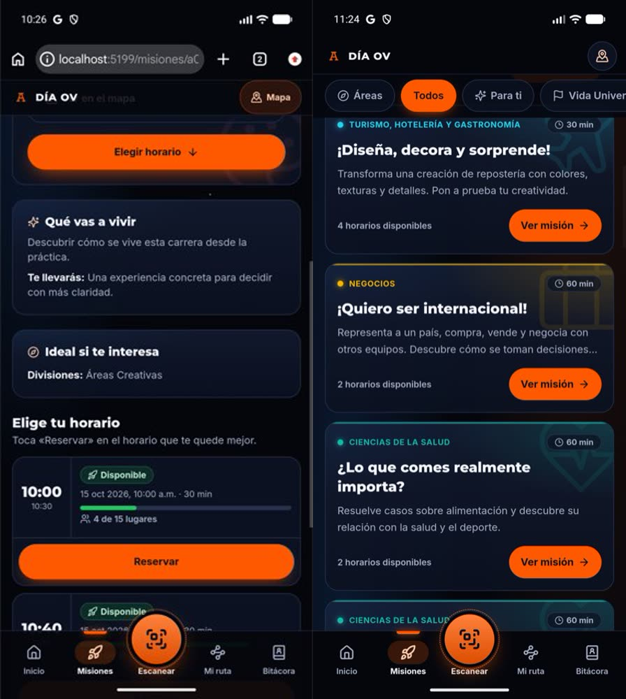
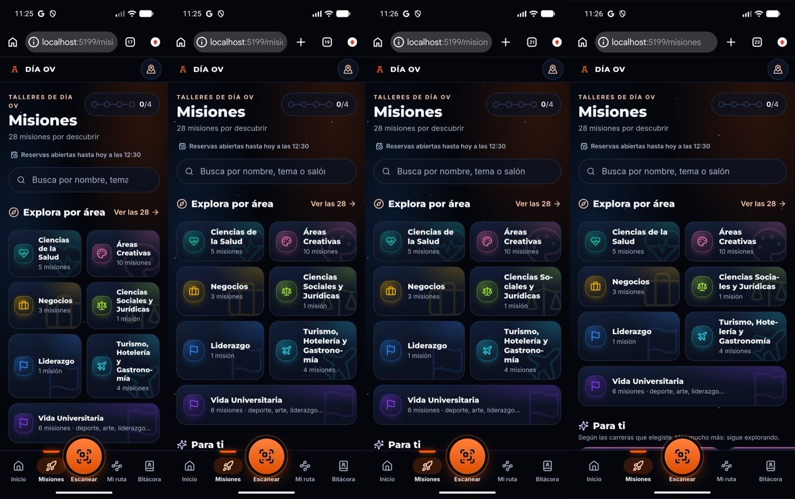
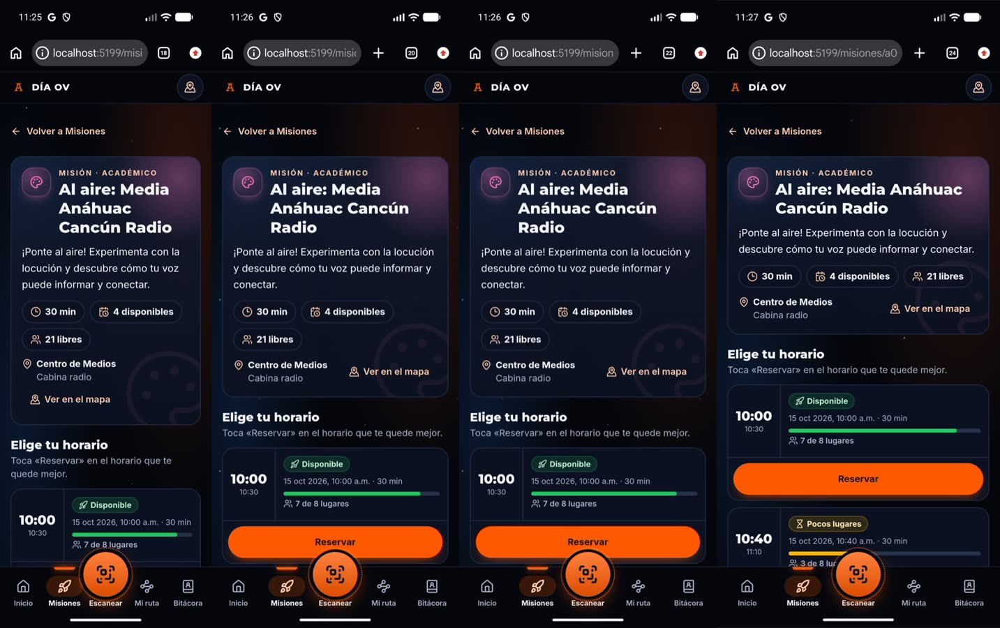
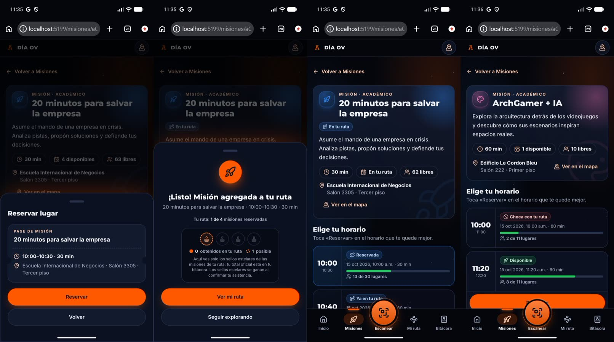
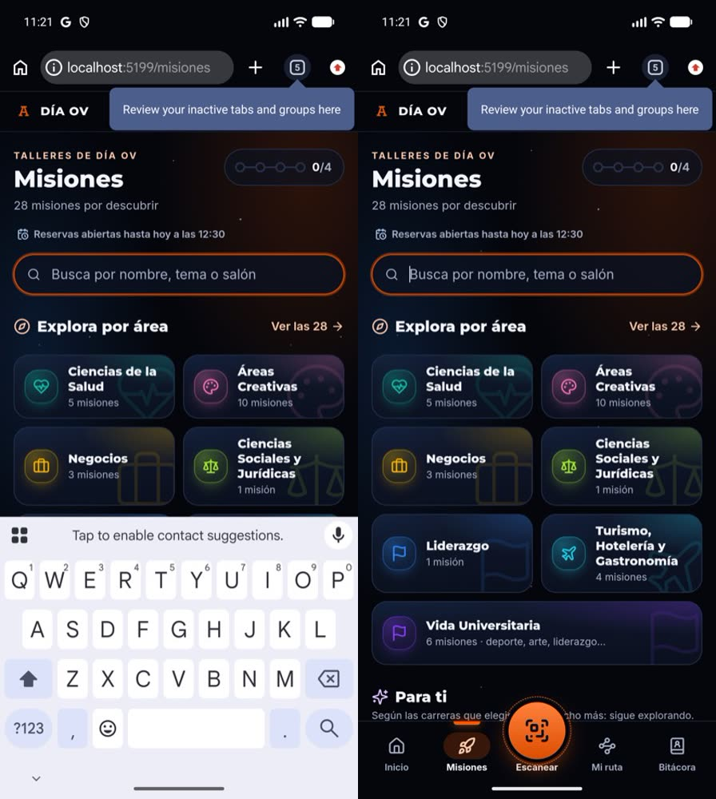
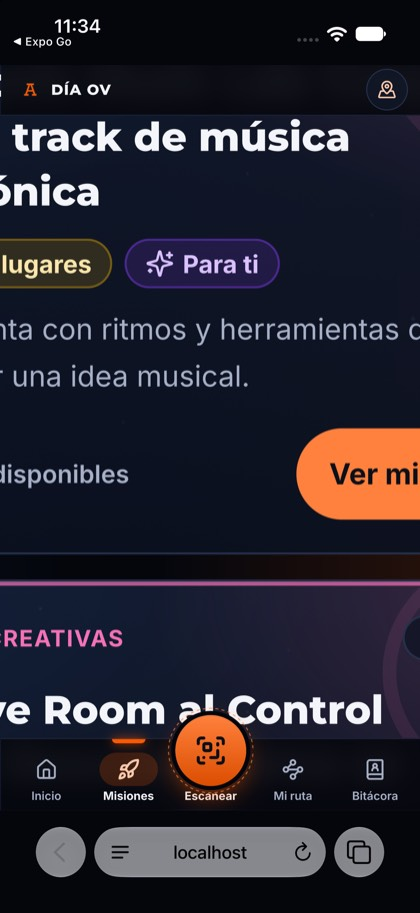

# Evolución integral UX/UI del alumno

Todo lo de aquí es frontend: no cambia datos, esquemas, RPC, reglas de reservación, QR, sellos, rangos, sorteo, autenticación ni permisos.
Las capturas son de la aplicación implementada (Chrome 149 real en un emulador Android y Safari de iOS 26 en el simulador de iPhone 17),
con el backend simulado local (nada de producción). La investigación previa es «Revisión UX Día OV» v2.

## 1. Problemas corregidos y causa

| # | Problema | Causa (verificada) | Corrección |
|---|---|---|---|
| 1 | La barra inferior y el encabezado quedan fuera de la pantalla tras un **zoom de pellizco** | Son `fixed`/`sticky`: se anclan al viewport de **diseño**; con zoom, la pantalla solo muestra una parte (a 2.2× la barra quedaba 297 px fuera) | `useVisualViewportAnchor`: con zoom, barra y encabezado siguen al área visible y se contraescalan por 1/zoom (mismo tamaño en pantalla). Sin zoom no hace nada |
| 2 | Pellizcar el **mapa** hacía zoom a toda la página | El plano no manejaba gestos; el navegador hacía zoom de página | El plano tiene pellizco, arrastre, Ctrl+rueda y botones +/−/restablecer; solo ahí se reserva el gesto |
| 3 | Texto que se transparenta tras el encabezado y la barra en **modo lite** | `lite` quita el blur pero dejaba 85–95 % de opacidad | `.chrome-surface`: sólido en `lite` y con «reducir transparencia» |
| 4 | **Recarga accidental** al arrastrar desde arriba (≈3 s sin marco) | Pull-to-refresh de Chrome | `overscroll-behavior-y: none` en la raíz |
| 5 | **Atrás** con la hoja de reservación abierta sacaba de la misión | La hoja no estaba en el historial | La hoja agrega una entrada de historial; Atrás la cierra |
| 6 | Al volver al catálogo se **perdía la posición** (3,000 px → 0) | El catálogo se carga de nuevo y `BrowserRouter` no restaura scroll | `ScrollManager`: arriba al entrar, posición exacta al volver |
| 7 | Barra inferior sobre el teclado o detrás de él | `fixed` en el viewport de diseño | `useKeyboardOpen`: se oculta mientras el teclado está arriba y vuelve con él |
| 8 | Botón Mapa de mucho peso visual | Cápsula naranja de 44 px con texto en un encabezado de 48 px | Círculo de vidrio de 40 px (48 px táctiles), solo ícono, sin competir con el CTA |
| 9 | Detalle de misión: 4 tarjetas antes de los horarios | Arquitectura de información | Resumen compacto → **horarios** → «Antes de ir» → «Sobre la misión» |
| 10 | «Para ti» primero hace pensar que son las únicas | Posición y tamaño (tarjetas de ≈330 px) | Áreas primero y completas; «Para ti» como fila que desliza y termina en «Y también…» |

Lo que **no** era un problema: el desfase de ±56 px que se midió con JavaScript durante la aparición y ocultación de la barra de Chrome.
Es una medida de diseño, no de pintado: en 413 fotogramas grabados durante 10 ciclos de desplazamiento, el botón Escanear se pintó en
y = 1102–1105 px de 1206 (variación de 3 px; ver `despues/barras-dinamicas.txt`). Nadie lo ve, así que no se «corrigió».

## 2. Decisiones de UX/UI y alternativas descartadas

**Navegación.** La barra se queda `fixed` (lo más sencillo y estable en los tres navegadores) y se le agrega lo que le faltaba, en lugar
de reconstruir el contenedor.
- *Descartado: bloquear el zoom* (`user-scalable=no`, `maximum-scale=1`, `touch-action` global). Quita accesibilidad y iOS lo ignora en parte.
- *Descartado: «app shell»* (barra fuera de `fixed`, contenedor con scroll propio). Elimina la barra dinámica de Chrome, pero **no resuelve el
  zoom** (con zoom, toda la cuadrícula se recorta igual), toca todas las pantallas y restaura peor el scroll. No hacía falta: la barra dinámica no se ve.
- *Descartado: un `z-index` más alto.* Nunca fue la causa.
- La referencia de coordenadas importa: Safari reporta `visualViewport.offsetTop` en coordenadas de página y Chrome en las del cliente
  (medido: scale 1.98, offset 100/183 y scroll 100/183 en iOS). Por eso el hook parte de la posición natural medida de cada barra y de
  `pageLeft/pageTop − scroll`, no de `innerHeight`.

**Mapa.** Con `touch-action: pan-y` a 1× (un dedo sigue desplazando la página y el pellizco es del plano) y `none` con zoom (el plano
captura el arrastre). El puntero se captura solo cuando ya es un gesto: capturarlo al tocar desviaba el clic y un toque simple nunca llegaba al edificio.

**Encabezado.** Mapa como círculo de vidrio, con nombre accesible y `title`. Se conserva el acceso global (con el origen para «Volver»).
*Descartados:* quitar el botón global (el mapa es la pregunta más frecuente del evento) y el encabezado contextual completo (cambia todas las pantallas).

**Detalle.** La información académica **no se quita**: se reordena. Resumen (nombre, descripción recortada a 3 líneas, tres datos en chips,
lugar con mapa) → horarios con su disponibilidad → «Antes de ir» (visible: son requisitos) → «Sobre la misión» (objetivo recortado a 4
líneas con «Leer más», «Te llevarás», primeras 4 carreras y «+N más», divisiones). «Leer más» aparece solo si el texto de verdad se
desborda (medido); el texto completo siempre está en el DOM. Se retiró el botón-ancla «Elegir horario»: ya no hace falta. Reservar pasa de 3 toques a 2.
*Descartado:* una barra de acción fija sobre la barra inferior (compite con ella) y una hoja de horarios (apila hoja sobre hoja).

**Misiones.** «N misiones por descubrir» (conteo real), áreas compactas con color, ícono y marca de agua (identidad espacial), «Ver las N»
en la misma fila del título de las áreas, y «Para ti» como fila deslizable con la siguiente tarjeta asomando. Su última tarjeta, «Y también…»,
lleva al área más grande **sin ninguna sugerencia** del alumno (conteo real; sin lógica de recomendación nueva). El medidor de ruta pasa al lado del
título. *Descartado:* intercambiar solo el orden (deja tres tarjetas grandes bajo las áreas) y una tarjeta «sorpréndeme» (lógica nueva).

**Coherencia.** Un solo tratamiento para las barras (`.chrome-surface`), áreas táctiles de 44 px o más, mismos tintes por área en tarjetas,
fichas y mapa, y una sola forma de tratar un modal con historial. Las animaciones respetan `prefers-reduced-motion`.

## 3. Componentes modificados

Nuevos: `lib/useVisualViewportAnchor.ts`, `lib/useKeyboardOpen.ts`, `student/ScrollManager.tsx`, `student/useDismissOnBack.ts`,
`student/campus/mapView.ts`, `student/ui/ClampedText.tsx`.
Modificados: `StudentLayout`, `BottomNav`, `ConfirmSheet`, `StudentWorkshopDetail`, `Missions`, `MissionExplorer`, `MissionCard` (variante
compacta), `ui/RouteMeter` (variante compacta), `campus/CampusMap`, `campus/mapLinks`, `index.css`.

## 4. Evidencia (aplicación implementada)

Comparativas (izquierda: antes · derecha: después):
- Misiones: 
- Detalle de misión: 
- Zoom 2.2× en Chrome Android: 
- Pellizco en el mapa: 
- Modo lite (transparencia): 
- Anchos 320 / 375 / 390 / 430 px, Misiones: 
- Anchos 320 / 375 / 390 / 430 px, detalle: 
- Hoja de reservación · éxito con sellos · reservada · conflicto: 
- Teclado abierto y cerrado: 
- Safari iOS con zoom: 

Mediciones en la propia página (Chrome Android, vía DevTools): `antes/zoom-medicion.txt`, `despues/zoom-medicion.txt`,
`despues/barras-dinamicas.txt`, `despues/lite.txt`.

| Comportamiento | Antes | Después |
|---|---|---|
| Barra tras pellizcar a 2.2× (Chrome Android) | brecha −327 px, fuera de la pantalla | brecha 0, a la vista, al tocar «Mi ruta» navega |
| Pellizco sobre el mapa | `visualViewport.scale` 2.0, barra fuera (−272 px) | `scale` 1; el plano a 2.67×; barra intacta |
| Regresar de una misión al catálogo largo | `scrollY` 0 (estaba en 3,000) | `scrollY` 2,135 → 2,135 |
| Atrás con la hoja abierta | salía de la misión | cierra la hoja, la misión se queda |
| Arrastre desde arriba | recargaba la app (probado con y sin la regla) | no recarga |
| Modo lite: fondo de barra y encabezado | `rgba(…, 0.95/0.85)` con texto detrás | `rgb(4, 6, 12)` sólido |
| Teclado abierto | barra detrás del teclado | barra oculta; vuelve al cerrarlo (aunque el campo conserve el foco) |
| Primera pantalla de Misiones (375×812) | 1 tarjeta «Para ti»; áreas a y = 1,296 | 6 áreas + Vida Universitaria a la vista; «Para ti» a continuación |
| Detalle: dónde empieza «Elige tu horario» | y ≈ 928 (primer «Reservar» en y ≈ 1,108) | primer horario con «Reservar» en la primera pantalla |

## 5. Pruebas

- Vitest: 105 archivos, 1,346 pruebas, todas pasan. Nuevas: `useVisualViewportAnchor` (matemática y hook, incluida la geometría medida en Safari),
  `useKeyboardOpen`, `useDismissOnBack` (con el historial real de jsdom, incluida la carrera de cerrar y abrir), `ScrollManager`,
  `mapView`, gestos del mapa (pellizco, arrastre, toque, botones, límites, Ctrl+rueda), `ClampedText`, detalle (orden, datos, carreras,
  requisitos, Atrás), landing de Misiones («Y también…» con conteos reales) y encabezado.
- Mutaciones comprobadas: sin retirar la entrada de historial, sin esperar la entrada que se está retirando, sin restauración de scroll y
  sin la guarda de clics tras un arrastre, las pruebas correspondientes fallan.
- `tsc -b` y `vite build` sin errores.

## 6. Cobertura real de navegadores

| Entorno | Tipo | Cubierto |
|---|---|---|
| Chrome 149 en Android 17 (Pixel 10 Pro, 1280×2856, 3×) | **emulador** | zoom, mapa, barras dinámicas (413 fotogramas), `lite`, recarga por arrastre, Atrás y hoja, restauración de scroll, teclado docked, 320/375/390/430 px, estados de reservación |
| Safari de iOS 26 (iPhone 17) | **simulador** | pellizco con barra y encabezado siguiendo al área visible; aplicación completa |
| Chrome de escritorio (panel integrado) | escritorio | mediciones previas |
| **Chrome para iPhone** | — | **no verificado**: no se puede instalar en el simulador |
| **Dispositivos físicos** (iPhone o Android) | — | **no verificados**. Nada de esto declara compatibilidad física |
| iOS: Atrás con la hoja, recarga por arrastre y teclado | — | no probados en iOS; se basan en comportamiento estándar y en las pruebas de jsdom |

Limitaciones conocidas:
- En iOS Safari las barras vuelven a su sitio **al terminar** el pellizco (el navegador emite el evento de zoom al final del gesto, no durante): durante el gesto acompañan al contenido y se acomodan en cuanto el dedo se levanta.
- Con zoom, el seguimiento depende de `visualViewport`; sin esa API (navegadores muy antiguos) todo queda como antes.
- El arranque tras una recarga sigue mostrando «Cargando» sin marco mientras se restaura la sesión (se evita la causa más común, el arrastre accidental, no el tiempo de arranque).
- El modal del aviso de ganador y la invitación a la encuesta no entran al historial (son diálogos bloqueantes).
- Zoom por debajo de 1× en iOS (la página se encoge): no se toca, es del navegador.

## 7. Lógica de negocio

No cambió: reservaciones, disponibilidad, tolerancia de inscripción, restricciones, conflictos, confirmaciones y errores usan los mismos
componentes y funciones (`SessionRow`, `sessionState`, `isSelectable`, `reserve/change/cancel`); el detalle y la landing solo reordenan
y reutilizan los mismos datos del tablero. Las pruebas de reservación existentes (disponibles, llenas, en curso, terminadas, reservadas,
cambios, conflictos, errores y confirmaciones) pasan sin modificar sus reglas.
